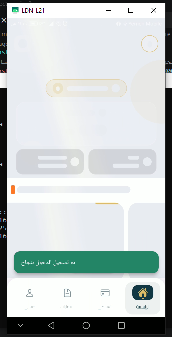
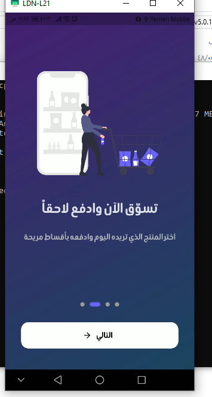
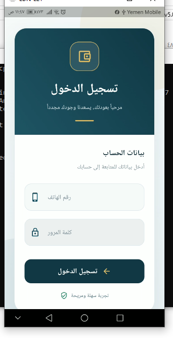
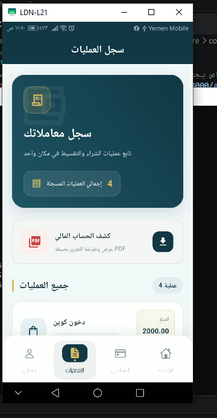
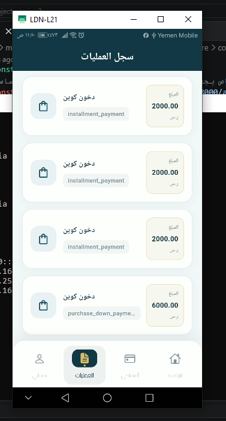
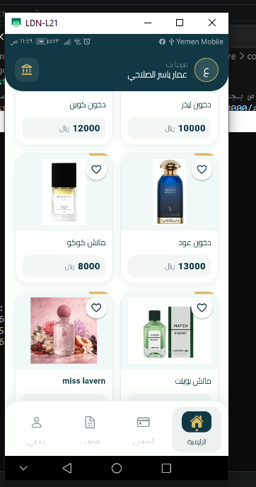

# Taqsit – Smart Installment Management System

A full-stack installment management platform designed to connect customers, merchants, and banks through an integrated digital purchasing and payment solution.

Taqsit consists of a Flutter mobile application for customers and a Laravel-based backend that provides RESTful APIs and management portals for merchants, banks, and administrators.

---

## 📱 Application Screenshots

### Customer Mobile Application

<p align="center">
  
  
  
  
  
  
</p>

### Installment Management

<p align="center">
 
  
</p>

### Management Dashboards

<p align="center">
  
</p>

---

## ✨ Key Features

### 1. Customer Mobile Application
- Browse available products and services.
- View product details and installment options.
- Submit installment purchase requests.
- Track installment schedules and payment status.
- Monitor remaining balances and upcoming payments.
- Receive payment-related notifications.

### 2. Merchant Portal
- Manage products and services.
- Set product prices and installment availability.
- Review customer installment requests.
- Monitor sales and payment records.
- Track amounts due and received.

### 3. Bank Portal
- Review customer installment applications.
- Evaluate customer financial eligibility.
- Approve or reject installment requests.
- Manage installment plans and financing settings.
- Monitor financial transactions and repayments.

### 4. Admin Dashboard
- Manage customers, merchants, and bank staff.
- Manage system users and permissions.
- Control general platform settings.
- Oversee platform operations.

---

## 🛠️ Tech Stack

| Layer | Technologies |
|---|---|
| Mobile Frontend | Flutter, Dart |
| Backend | PHP, Laravel |
| Database | MySQL |
| API Architecture | RESTful APIs |
| Version Control | Git, GitHub |

---

## 📂 Repository Structure

```text
myproject_taqsit/
│
├── taqditapp-frontend-3/
│   └── Flutter Customer Mobile App
│
├── taqsit-backend-main/
│   ├── Laravel Backend
│   ├── RESTful APIs
│   ├── Merchant Management
│   ├── Bank Management
│   └── Admin Management
│
└── screenshots/
    ├── home.png
    ├── products.png
    ├── product_details.png
    ├── installment.png
    ├── transactions.png
    └── dashboard.png
```

---

## ⚙️ Requirements

- Flutter SDK
- Dart SDK
- PHP
- Composer
- MySQL
- Laravel-compatible environment

---

## 🚀 Getting Started

### 1. Clone the Repository

```bash
git clone https://github.com/ammaralsalahi/final-year-project-fullstack.git
```

### 2. Run the Flutter Application

```bash
cd taqditapp-frontend-3
flutter pub get
flutter run
```

### 3. Set Up the Laravel Backend

```bash
cd taqsit-backend-main
composer install
```

Configure your database credentials in the `.env` file, then run:

```bash
php artisan key:generate
php artisan migrate
php artisan serve
```

---

## 🎯 Project Goals

- Demonstrate full-stack mobile application development.
- Integrate Flutter applications with Laravel RESTful APIs.
- Implement multi-role management workflows.
- Design an integrated installment purchasing experience.
- Practice database management and backend integration.

---

## 👨‍💻 Developer

**Ammar Yaser Alsalahi**

IT Graduate | Flutter Developer | Full-Stack Mobile Development

- GitHub: [ammaralsalahi](https://github.com/ammaralsalahi)
- LinkedIn: [Ammar Yaser Alsalahi](https://www.linkedin.com/in/ammar-yaser-alsalahi-1ab8bb379/)

---

*Developed as a practical software project to demonstrate mobile application development, backend integration, and multi-role system design.*
